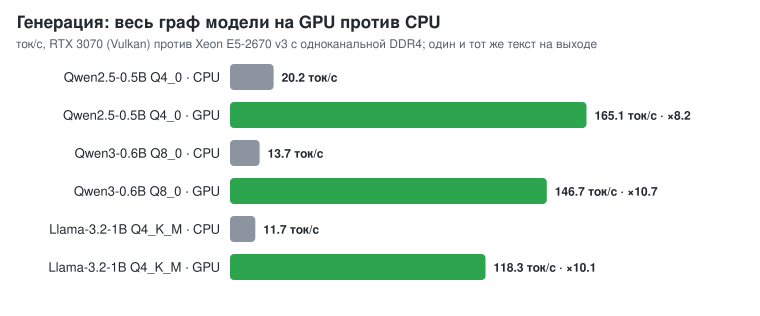
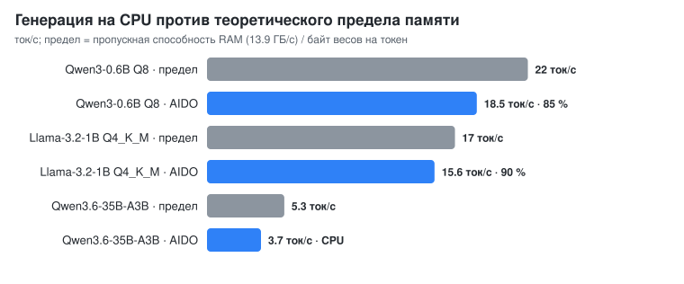
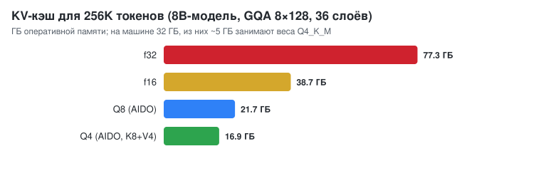
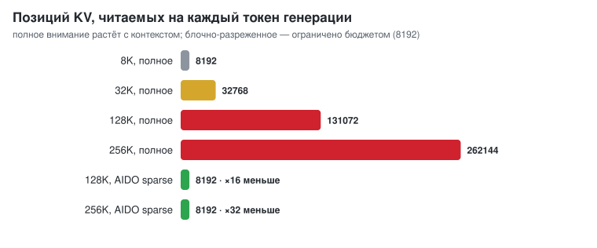
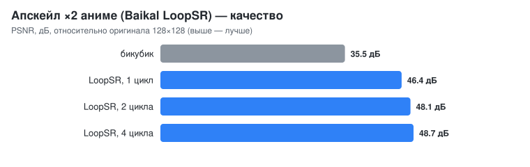
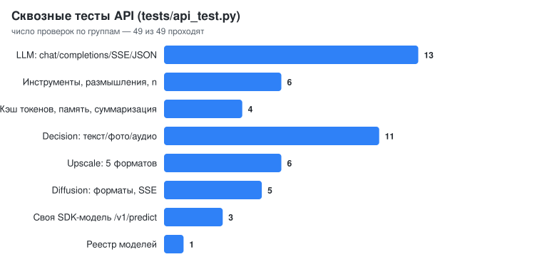

<div align="center">

# AIDO

**Адаптивный движок локального ИИ на Rust**

LLM · модели решений (текст + фото + звук) · генерация изображений · апскейл ·
свои нейросети — в одном бинарнике, через OpenAI-совместимый API или как
библиотека внутри вашего приложения.


</div>

---

## Установка одной строкой

**Windows (PowerShell)**
```powershell
irm https://raw.githubusercontent.com/Nopass0/aido/main/install.ps1 | iex
```

**Linux / macOS**
```bash
curl -fsSL https://raw.githubusercontent.com/Nopass0/aido/main/install.sh | sh
```

Скрипт ставит Rust (если его нет), собирает AIDO **под ваш процессор**
(`target-cpu=native`) и делает `aido` глобальной командой в cmd,
PowerShell, bash и zsh. Подробнее — [docs/INSTALL.md](docs/INSTALL.md).

## За 30 секунд

```bash
aido pull Qwen/Qwen3-8B-GGUF                         # скачать любую модель с Hugging Face
aido run  -m hf:Qwen/Qwen3-0.6B-GGUF -p "Привет!"    # hf:-путь работает в любой команде
aido chat -m models/Qwen--Qwen3-8B-GGUF/Qwen3-8B-Q4_K_M.gguf
aido serve -m qwen=hf:Qwen/Qwen3-0.6B-GGUF -m d1=models/d1-omni \
           -m x2=models/baikal/Baikal_LoopSR_x2_v2.safetensors --sd models/sd-turbo --taesd models/taesd
```

```python
from openai import OpenAI
c = OpenAI(base_url="http://127.0.0.1:8080/v1", api_key="none")
print(c.chat.completions.create(model="qwen", messages=[{"role": "user", "content": "Столица Франции?"}]).choices[0].message.content)
```

## Что умеет

| | Возможность | Где |
|---|---|---|
| 💬 | **LLM**: Llama, Qwen 2.5/3, Mistral, Qwen3.5/3.6 MoE (35B прямо из папки), форматы GGUF Q4_0…Q8_0, K-кванты, F16/BF16, свой `.aido` | `aido run/chat`, `/v1/chat/completions` |
| 🧰 | **Диалог**: системное сообщение, история, **инструменты** (function calling), **размышления** (`reasoning_content`), `n` вариантов, JSON-режим, стриминг SSE | [docs/CHAT.md](docs/CHAT.md) |
| 🧠 | **Долгосрочная память**: векторная база (гибрид эмбеддингов и BM25), модель сама вызывает `memory_search` / `memory_save` | [docs/CHAT.md](docs/CHAT.md#долгосрочная-память-векторная-база) |
| 📜 | **Длинный контекст 128–256K**: KV-кэш постраничный, сжатый (Q8/Q4), блочно-разреженное внимание, автосуммаризация истории, кэш токенов префикса | [docs/LONG_CONTEXT.md](docs/LONG_CONTEXT.md) |
| 🎯 | **Модели решений** (LiquidAI d1-Omni): типизированные ответы (да/нет, выбор, шкала, число, рамка) по тексту, фото и звуку за один проход | `/v1/decide` |
| 🖼 | **Генерация изображений** (SD-Turbo и SD-семейство) с превью каждого шага по SSE | `aido image`, `/v1/images/generations` |
| 🔍 | **Апскейл** (Baikal LoopSR и аналоги): картинка, папка кадров, поток кадров | `aido upscale`, `/v1/images/upscale` |
| 🏗 | **SDK**: автоград, **Muon** + AdamW, чекпоинты, свои модели с **сигнатурой входа/выхода**, компиляция, запуск через CLI, сервер и библиотеку | [docs/SDK.md](docs/SDK.md) |
| 🔧 | **Хирургия моделей**: анализ нейронов и слоёв, прунинг, удаление слоёв, обрезка словаря, переквантизация, правка срезов весов, управление поведением | `aido analyze/compile/weights/steer` |
| 📦 | **Библиотека**: `aido::Models` — все модели в вашем Rust-приложении без HTTP | [docs/EMBEDDING.md](docs/EMBEDDING.md) |
| 🌐 | **Несколько моделей на слабом ПК**: ленивая загрузка, общий пул и GPU, общие mmap-страницы, LRU в бюджете ОЗУ | [docs/API.md](docs/API.md) |

## Производительность

Измерено на машине разработки: Xeon E5-2670 v3 (12 ядер), 32 ГБ DDR4 в
**одном канале** (13.9 ГБ/с), RTX 3070 8 ГБ. Методика и полные таблицы —
[docs/RESEARCH.md](docs/RESEARCH.md).

<p align="center"></p>

**Весь граф модели на GPU** (`src/gpu/llama.rs`). Веса, KV-кэш и
активации живут в VRAM. Прямой проход токена записывается в один буфер
команд с одним чтением логитов: матрично-векторное ядро на 8 строк, слитые
q|k|v и gate|up, RMSNorm, RoPE, внимание. Получается 8–11-кратный выигрыш
и 118–165 ток/с у моделей 0.5–1B на RTX 3070 при том же тексте на выходе.
Модель, которая не помещается в общий бюджет VRAM (`--vram-gb`), идёт по
CPU-пути.

<p align="center"></p>

На CPU генерация упирается в пропускную способность памяти: каждый токен
читает все веса. AIDO выходит на 85–90 % этого предела.

<p align="center"></p>
<p align="center"></p>

| Длинный контекст: Llama-3.2-1B, 15.5K токенов, «иголка в стоге сена» | Ответ | KV-память |
|---|---|---|
| f16, полное внимание (как раньше) | ✅ BLUE-FALCON-4721 | 528 МБ |
| Q8, полное | ✅ | 288 МБ |
| Q8, разреженное (бюджет 4096) | ✅ | 288 МБ, генерация ×1.4 |
| Q4 (K8+V4), разреженное | ✅ | 224 МБ, генерация ×1.6 |

Подробности — [docs/LONG_CONTEXT.md](docs/LONG_CONTEXT.md).

<p align="center"></p>
<p align="center"></p>

## Документация

| Документ | О чём |
|---|---|
| [INSTALL.md](docs/INSTALL.md) | установка, сборка, скачивание моделей |
| [API.md](docs/API.md) | HTTP API целиком: все эндпоинты, поля, форматы, стриминг |
| [CHAT.md](docs/CHAT.md) | системные сообщения, инструменты, размышления, память, автосуммаризация |
| [LONG_CONTEXT.md](docs/LONG_CONTEXT.md) | как 128–256K токенов помещаются в ОЗУ без потери скорости |
| [EMBEDDING.md](docs/EMBEDDING.md) | движок внутри своего Rust-приложения |
| [SDK.md](docs/SDK.md) | свои модели: обучение (Muon), сигнатуры входа/выхода, компиляция, запуск |
| [UPSCALE.md](docs/UPSCALE.md) | апскейл картинок и видео |
| [RESEARCH.md](docs/RESEARCH.md) | исследование: где реальная скорость, замеры, выводы |

Каждая публичная функция задокументирована в rustdoc (вход, выход,
поведение, пример): `cargo doc --open`. Примеры компилируются и
проверяются `cargo test --doc`.

## Команды

```bash
aido info                                   # CPU, кэши, RAM, GPU
aido run    -m model.gguf -p "…" [--kv q8|q4|f16] [--kv-budget 8192] [--ctx 131072]
aido chat   -m model.gguf
aido bench  -m model.gguf                   # prefill / decode / спекуляция
aido serve  -m name=path … [--ram-gb 12] [--memory-dir data/memory]
aido decide -m models/d1-omni -q @q.json --state "текст" --image cat.jpg --audio a.wav
aido image  --sd models/sd-turbo --taesd models/taesd -p "a red fox" -o fox.png
aido upscale -i in.png -o out.png [--loops 1] | -i frames/ -o out/ | --stream 640x360
aido pull   org/repo [-f "*Q4_K_M*"]
aido analyze / compile / eval / verify / weights / steer / behave   # оптимизация и хирургия
aido train-lm / finetune / train-seq / train-classifier / train-image / train-pixelart / train-snake / train-textdet
aido model-info models/seq.aido             # сигнатура входа/выхода своей модели
aido predict -m models/seq.aido -i '{"sequence":[2,4,6,8]}'
aido install                                # глобальная команда aido
```

## Архитектура

| Модуль | Назначение |
|---|---|
| `models` | реестр моделей любых типов: ленивая загрузка, LRU, общий пул/GPU; чат, решения, апскейл, генерация, predict |
| `server` | OpenAI-совместимый HTTP API (axum), SSE |
| `llm` | Llama/Qwen/Mistral, Qwen3.5/3.6 MoE, LFM3, d1; движок, спекуляция, шаблоны чата, инструменты, размышления |
| `llm::kv` | постраничный сжатый KV-кэш, разреженное и блочное flash-внимание, split-K |
| `memory`, `vector` | долгосрочная память, векторная база, эмбеддер |
| `runtime` | пул потоков с привязкой к ядрам, калибровка ширины, термозащита |
| `tensor` | кванты GGML, AVX2-ядра, упакованная GEMM |
| `gpu` | wgpu (Vulkan/DX12/Metal): matvec, GEMM, эксперты MoE в VRAM |
| `diffusion`, `upscale` | SD-конвейер, LoopSR |
| `sdk` | автоград, Muon/AdamW, данные, модели, сигнатуры `io` |
| `format`, `hub` | GGUF, safetensors, `.aido`; Hugging Face |
| `optimize`, `weights`, `steer`, `evals` | анализ, компиляция, правка весов, управление поведением, бенчмарки |

## Честно: ограничения и дорожная карта

| Что | Состояние |
|---|---|
| 150+ ток/с на **большой** (8B) модели на RTX 3070 | ❌ пока нет. 8B Q4_K_M в GPU-формате весит 6.3 ГБ, а другие программы занимают 2.9 ГБ из 8. Модель целиком в VRAM не помещается и идёт по CPU-пути (~2 ток/с при одноканальной RAM). В работе: 6-битный GPU-формат для Q6_K и гибрид «часть слоёв на GPU, часть на CPU». Если освободить VRAM, по пропускной способности 8B Q4 выходит на ~60–80 ток/с, а со спекулятивным декодированием — больше |
| Prefill на GPU | по одному токену на проход (~140 ток/с); пакетный prefill и пакетная проверка черновиков — в работе |
| Мультимодальные LLM (картинка в чате) | изображения и звук сейчас принимает модель решений d1 (`/v1/decide`). Vision-LLM (Qwen2.5-VL и подобные) в чате пока не поддерживаются |
| Апскейл видео в реальном времени | LoopSR весит ~23 МФЛОП на пиксель, поэтому в реальном времени работают только маленькие кадры ([UPSCALE.md](docs/UPSCALE.md)). Полный перенос сети на GPU — в работе |
| Длинные входы у d1 / изображений / звука | у LLM есть сжатый KV и разреженное внимание. У d1 внимание пока полное, лимит изображения задаёт `AIDO_VISION_MAX_PIXELS` |
| Muon в SDK | реализован и включён по умолчанию. Публикации сообщают о ~2× эффективности на больших LLM, на маленьких моделях SDK выигрыш скромнее (`aido --optimizer adamw …` для сравнения) |
| Генерация музыки (ACE-Step из ComfyUI) | не реализована |

## Лицензия

MIT
