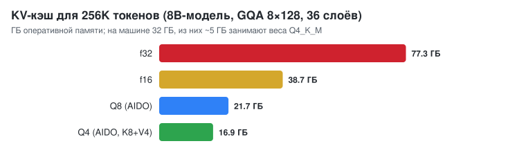
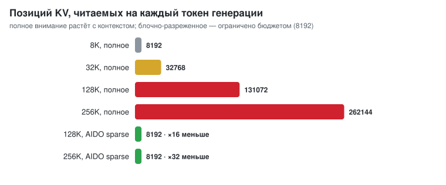

# Длинный контекст: 128–256K токенов в обычной ОЗУ

## Проблема

Веса модели читаются по одному разу на токен, а KV-кэш (ключи и значения
внимания всех прошлых токенов) растёт с длиной контекста. Для 8B-модели с
GQA (36 слоёв × 8 KV-голов × 128) один токен контекста стоит
`2 × 36 × 1024` чисел:

<p align="center"></p>

В f16 256K токенов — это 38.7 ГБ, больше всей памяти машины (32 ГБ). При
полном внимании каждый новый токен должен ещё и прочитать весь кэш: на
256K это ~38 ГБ чтения на токен, то есть несколько секунд на токен при
13.9 ГБ/с.

## Решение AIDO (`src/llm/kv.rs`)

### 1. Страничный кэш
Память выделяется страницами по 64 позиции по мере роста контекста.
Сессия с лимитом 256K, в которой пока 2K токенов, занимает память под
2K токенов. После отката (новый запрос с другим хвостом) лишние страницы
освобождаются.

### 2. Сжатие
Ключи и значения хранятся целыми числами группами по 32 с масштабом f16:

| `--kv` | Ключи | Значения | Байт/значение | 128K (8B) | 256K (8B) |
|---|---|---|---|---|---|
| `f16` | f16 | f16 | 2.0 | 19.3 ГБ | 38.7 ГБ |
| **`q8`** (по умолчанию) | int8 | int8 | 1.06 | 10.9 ГБ | 21.7 ГБ |
| `q4` | int8 | int4 | 0.81 | 8.4 ГБ | 16.9 ГБ |

Ключи даже в режиме `q4` остаются 8-битными. У ключей есть каналы-выбросы,
и 4 бита их разрушают: в тесте Qwen3-0.6B с ключами в int4 выдавал мусор.
Значения такой чувствительности не имеют (наблюдение KIVI). Внимание
считается прямо по целым числам, без распакованной копии.

### 3. Блочно-разреженное внимание (при контексте больше бюджета)
Для каждой страницы хранятся покомпонентные `min` и `max` ключей. Для
запроса `q` скалярное произведение с любым ключом страницы ограничено
сверху величиной `Σ_c max(q_c·min_c, q_c·max_c)`. Точное внимание
считается по объединению:

* первых `sink` позиций (по умолчанию 64): «стоки внимания», на которые
  модели опираются всегда;
* последних `--kv-recent` позиций (по умолчанию 2048);
* страниц с наибольшей верхней оценкой — пока не набран `--kv-budget`
  позиций (по умолчанию 8192).

Страница с низкой оценкой не может получить заметную долю softmax, поэтому
результат близок к полному вниманию. При этом токен читает не весь
контекст, а только `budget` позиций:

<p align="center"></p>

До `budget` позиций внимание точное. `--kv-budget 0` включает точное
внимание всегда.

### 4. Параллельность
* **Генерация (split-K, flash-decoding).** Когда задач «токен × KV-голова»
  меньше, чем ядер (у маленьких моделей 2–8 KV-голов), контекст режется
  на части по ядрам, а частичные softmax сливаются через log-sum-exp. Без
  этого на 16K контекста работали бы 2 ядра из 12.
* **Prefill (блочное flash-внимание).** Запросы обрабатываются блоками по
  16. Тайл из 64 ключей и значений распаковывается в f32 один раз на блок,
  softmax считается онлайн. На длинном контексте разреженный выбор страниц
  делается один раз на блок запросов (по максимуму оценки), поэтому
  prefill тоже не квадратичный.

### 5. История диалога и кэш токенов
* Префиксный кэш: продолжение диалога пересчитывает только новые токены
  (`usage.prompt_tokens_details.cached_tokens`).
* Если история не помещается даже так, старые сообщения автоматически
  сворачиваются в краткое изложение той же моделью ([CHAT.md](CHAT.md)).
* Долгосрочная память (векторная база) выносит факты из контекста
  совсем: модель находит их поиском, когда они нужны.

## Использование

```bash
aido run -m model.gguf --ctx 131072 --kv q8 -p @book.txt          # 128K, Q8, разреженное внимание выше 8192
aido run -m model.gguf --ctx 262144 --kv q4 --kv-budget 8192 -p @big.txt
aido run -m model.gguf --ctx 32768 --kv f16 --kv-budget 0 -p @doc.txt   # точно, без сжатия
```

Сервер и библиотека используют те же настройки (`EngineOptions.kv`,
`aido::llm::kv::KvConfig`).

## Измерения: «иголка в стоге сена»

Документ из «Алисы в Стране чудес» (~15.5K токенов), на 15 % глубины
вставлена фраза «The secret code for the vault is BLUE-FALCON-4721», в
конце вопрос о коде. Модель — Llama-3.2-1B-Instruct Q4_K_M, только CPU.

| Режим | Ответ | KV-память | Prefill | Генерация |
|---|---|---|---|---|
| `--kv f16 --kv-budget 0` (точно, как раньше) | ✅ BLUE-FALCON-4721 | 528 МБ | 30.7 ток/с | 2.7 ток/с |
| `--kv q8 --kv-budget 0` | ✅ BLUE-FALCON-4721 | 288 МБ (−45 %) | 26.6 ток/с | 1.6 ток/с |
| `--kv q8 --kv-budget 4096 --kv-recent 1024` | ✅ BLUE-FALCON-4721 | 288 МБ | 44.4 ток/с | 3.8 ток/с |
| `--kv q4 --kv-budget 4096 --kv-recent 1024` | ✅ BLUE-FALCON-4721 | 224 МБ (−58 %) | 41.4 ток/с | 4.4 ток/с |

Скорости в этой таблице измерены на загруженной машине: параллельно шла
компиляция. Сравнивать их можно только между собой. Разреженный режим
читает 4096 позиций вместо 15.5K, поэтому и prefill, и генерация у него
быстрее точного. Воспроизведение: `sh scripts/needle.sh <model.gguf>`.

## Честно о пределах

* Prefill 128K+ токенов на CPU всё равно долгий: это миллиарды операций на
  слой. Разреженный prefill сокращает работу внимания, но умножения на
  веса остаются (~2·N·параметров ФЛОП). Для 8B-модели и 128K токенов это
  ≈2 ПФЛОП, то есть часы на этом CPU и десятки минут на GPU.
* Разреженное внимание — приближение. Оно ищет нужные страницы по верхней
  оценке, и на тестах с «иголкой» находит её, но в задачах, где ответ
  размазан по всему документу, `--kv-budget` стоит увеличить.
