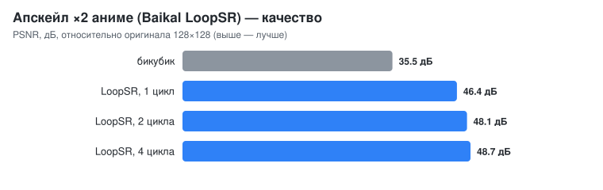

# Апскейл изображений и видео (Baikal LoopSR и аналоги)

AIDO запускает super-resolution модели семейства **LoopSR**
([SnJake/Baikal-Anime-Upscaler](https://huggingface.co/SnJake/Baikal-Anime-Upscaler))
напрямую из `.safetensors`: архитектура читается из метаданных файла,
никакой Python не нужен.

```bash
aido pull hf:SnJake/Baikal-Anime-Upscaler:Baikal_LoopSR_x2_v2.safetensors
aido upscale -i frame.png -o frame_x2.png                 # одна картинка (любой формат на входе и выходе)
aido upscale -i frames/ -o frames_x2/ --loops 1           # папка кадров (видео, разложенное на кадры), FPS в конце
ffmpeg -i in.mp4 -f rawvideo -pix_fmt rgb24 - | \
  aido upscale --stream 640x360 --loops 1 | \
  ffmpeg -f rawvideo -pix_fmt rgb24 -s 1280x720 -r 24 -i - out.mp4   # поток кадров через stdin/stdout
```

`--loops N` — сколько раз прогоняется общее (зацикленное) тело сети:
модель обучена на 4, меньше — быстрее при небольшой потере качества.

## Как устроено

`lr → stem 3×3 → 3 блока → 4 общих блока × loops → 2 блока → refine 3×3 (+скип)
→ head (3×3, GELU, 3×3, PixelShuffle) + бикубик(lr)`. Каждый блок — Swin-подобный
трансформер: LayerNorm → внимание в окнах 8×8 с относительным смещением
позиций (через блок — сдвиг окон на 4 с маской регионов; в общем теле —
*exclusive self-attention*: из выхода удаляется компонента вдоль
собственного value токена) → LayerNorm → `fc1` → depthwise 3×3 → GELU-гейт →
`fc2`, обе ветви с обучаемым масштабом по каналам.

Оптимизации реализации:

| Что | Как |
|---|---|
| Линейные слои | все пиксели кадра — одна упакованная f32 GEMM (BLIS 6×16), ~230 ГФЛОП/с на 12 ядрах |
| Оконное внимание | Q/K/V окна собираются один раз в непрерывные буферы по головам, таблица относительных смещений развёрнута при загрузке, скалярные произведения на 8 аккумуляторах (AVX) |
| Depthwise 3×3 | веса переложены «тап-major», внутренний цикл по каналам непрерывен и векторизуется |
| LayerNorm, residual | параллельно по пикселям |
| Бикубик | точная копия PyTorch (`a = −0.75`, `align_corners=False`) — нужен, т.к. сеть предсказывает остаток к нему |

## Измерено (Xeon E5-2670 v3, 12 ядер)

Качество: картинку 128×128 уменьшили до 64×64 и восстановили ×2.



| Вход | Циклы | Время | Кадров/с |
|---|---|---|---|
| 64×64 → 128×128 | 4 | 1.1 с | 0.9 |
| 128×72 → 256×144 (поток) | 1 | 1.2 с | 0.8 |
| 160×96 → 320×192 | 1 / 4 | 2.2 / 3.8 с | 0.45 / 0.26 |
| 256×256 → 512×512 | 1 / 4 | 8.1 / 16.0 с | 0.12 / 0.06 |

**Честно про реальное время.** LoopSR — тяжёлая трансформерная сеть:
≈13 МФЛОП на входной пиксель при 1 цикле и ≈23 при 4. Кадр 640×360 — это
3–5 ТФЛОП; для 24 кадров/с нужно ~100 ТФЛОП/с, что больше пиковой
производительности RTX 3070 (≈20 ТФЛОП/с f32) и в сотни раз больше CPU.
Поэтому на этом железе модель работает покадрово «офлайн» (папка кадров
или поток), а в реальном времени — только на маленьких кадрах. GPU-путь
(`AIDO_SR_GPU=1`) сейчас медленнее CPU: каждый слой гоняет активации по
PCIe туда и обратно; полный перенос сети на GPU с активациями в VRAM —
в планах (см. README, «Дорожная карта»).

## API и библиотека

* HTTP: `POST /v1/images/upscale` — [API.md](API.md#post-v1imagesupscale).
* Rust: `models.upscale("x2", &img, Some(1))` — [EMBEDDING.md](EMBEDDING.md).
